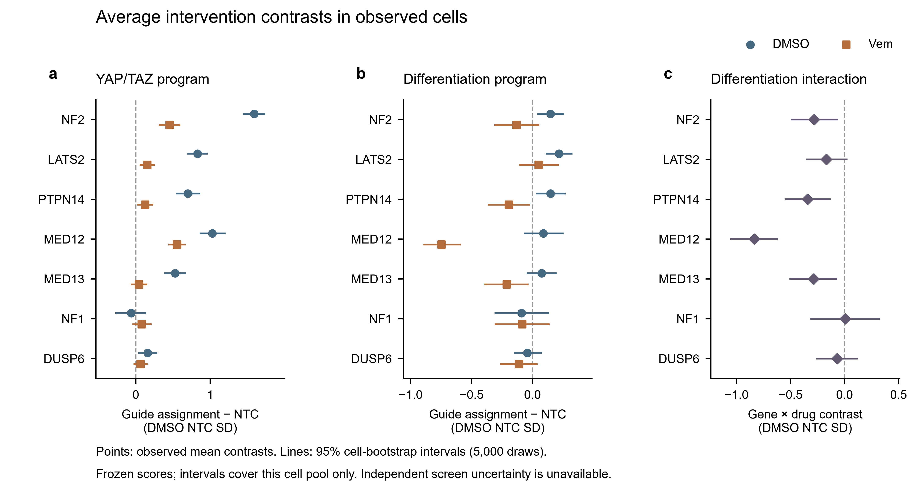

# 共同 YAP 相关背景下，MED12 敲低减弱黑色素瘤的药物诱导分化响应

PerturbFate 初步研究报告 · 2026-10-11

## 摘要

不同基因扰动可以汇入相似的耐药相关状态，但其对药物诱导分化的影响仍可能不同。我们整合平均处理效应（ATE）分析、细胞特异因果网络（CSCN）和基因空间 Causal Katz Matrix（CKM），分析 PerturbFate 中 7,125 个 A375 细胞的干预响应。NF2、MED12 和 MED13 敲低在无药条件下均增强 YAP/TAZ 相关程序，而 MED12 敲低后的药物诱导分化响应明显减弱。分化程序在 NTC、NF2 和 MED13 背景中的增幅分别为 1.128、0.847 和 0.842 SD，在 MED12 背景中为 0.293 SD。CKM 进一步解析了共同的药物相关状态重分布，CSCN 则在部分细胞中建立了 NF2 与 YAP 相关程序之间的干预兼容方向。上述结果支持一个统一解释：**共同的 YAP 相关输出与扰动特异的分化响应可以并存，MED12 是连接这两层现象的重要切入点。**

## 1. 研究背景与问题

黑色素瘤对 MAPK 抑制的响应与细胞分化状态密切相关。PerturbFate 通过多组学扰动分析提出，Hippo/YAP 抑制因子与 Mediator kinase module 的扰动可汇入共同的去分化及耐药相关程序；在这一共同背景上，MED12 敲低还表现出更强的 SOX10 相关分化功能受损。[1]

这一发现引出了一个具体问题：**共享 YAP 相关输出的扰动，是否保留不同程度的药物诱导分化能力？** 我们选择 NF2 作为 Hippo/YAP 支路对照，MED13 作为 Mediator kinase module 内部对照，围绕 MED12 的分化响应建立定量比较。ATE 衡量程序响应幅度，CKM 组织细胞状态，CSCN 连接局部网络结构与干预信息，形成从群体响应到细胞异质性再到候选调控方向的证据链。

## 2. 结果

### 2.1 多类扰动共享无药条件下的 YAP 相关输出

我们分析了 DMSO 和 vemurafenib（Vem）条件下的 NTC 及七个合格敲低靶点。使用外部黑色素瘤 YAP/TAZ-up 程序评分，[3] NF2、MED12 和 MED13 敲低相对 NTC 的效应分别为 +1.588、+1.028 和 +0.527 SD。LATS2 和 PTPN14 也呈现相同方向，效应分别为 +0.828 和 +0.699 SD。这一多扰动模式与原文提出的 Hippo–Mediator 共同输出一致。

药物环境进一步区分了这些响应。Vem 下，NF2 和 MED12 相对 NTC 的 YAP 程序效应分别为 +0.453 [0.308, 0.599] 和 +0.554 [0.438, 0.671] SD；MED13 为 +0.044 [−0.064, 0.153] SD，接近对照水平。共同的无药背景由此呈现出不同的药物条件依赖性。

### 2.2 MED12 敲低后的分化程序增幅小于 NF2 和 MED13

我们采用外部 SOX10 结合关联色素分化程序，[2] 比较每个干预背景下的 Vem−DMSO 平均响应。NTC 中该程序上升 +1.128 SD，NF2 和 MED13 中分别上升 +0.847 和 +0.842 SD；MED12 中的增幅为 +0.293 SD。

| 干预背景 | DMSO / Vem 细胞数 | 无药 YAP 程序：KD−NTC | 分化程序：Vem−DMSO |
| --- | ---: | ---: | ---: |
| NTC | 1,989 / 1,864 | 参考 | +1.128 [1.057, 1.199] |
| NF2 KD | 387 / 171 | +1.588 [1.442, 1.736] | +0.847 [0.639, 1.056] |
| MED12 KD | 162 / 203 | +1.028 [0.858, 1.205] | **+0.293 [0.082, 0.503]** |
| MED13 KD | 273 / 170 | +0.527 [0.380, 0.672] | +0.842 [0.630, 1.046] |

数值为各读出冻结的 DMSO NTC 标准差单位；方括号为 95% 细胞 bootstrap 区间（5,000 次重抽样）。

MED12 的基因×药物交互为 **−0.835 [−1.058, −0.613] SD**。直接比较响应幅度，MED12−NF2 为 **−0.554 [−0.850, −0.257] SD**，MED12−MED13 为 **−0.549 [−0.839, −0.257] SD**。这些差异说明，MED12 的分化响应减弱既区别于 Hippo 支路，也区别于同一 Mediator 模块中的 MED13。

这一差异在程序层面尤为清楚。MED12 的 SOX10 RNA 基因×药物交互为 −0.012 [−0.207, 0.184] SD，而分化程序出现较大的负交互。因此，对 MED12 表型的解释需要同时考虑转录因子表达与下游程序输出；SOX10 转录本的药物响应不足以概括整个分化响应。

**图 1｜共同输出背景与分化响应差异。** a，YAP/TAZ 程序的 KD−NTC 效应；b，分化程序的 KD−NTC 效应；c，分化程序的基因×药物交互。点和线分别表示效应估计与 95% 细胞 bootstrap 区间。

### 2.3 基因空间 CKM 解析了共同的药物相关状态重分布

为将平均响应放回细胞异质性背景，我们通过官方 NMF 预处理和每细胞 CSCN 构建 CKM，再乘回同一次 NMF 的载荷矩阵 H，获得细胞×基因表示。[5] 最终矩阵包含 2,005 个基因坐标，7,049 个细胞进入状态分析。基于该表示得到六个状态，并使用输入特征之外的外部表达程序进行生物注释。[2–4]

S3 具有较高的 YAP/TAZ-up、未分化及细胞周期读出。DMSO 中，S3 在 NTC 的比例为 20.8%，在 NF2、MED12 和 MED13 中分别为 46.4%、36.4% 和 34.2%。Vem 下，各组 S3 比例均下降，更多细胞分布于 S1 和 S4；其中 S4 具有较高的 SOX10 结合关联色素分化读出。

| 干预背景 | DMSO 中 S3 | Vem 中 S3 | Vem 中 S4 |
| --- | ---: | ---: | ---: |
| NTC | 20.8% | 0.8% | 52.3% |
| NF2 KD | 46.4% | 1.2% | 37.4% |
| MED12 KD | 36.4% | 3.0% | 43.3% |
| MED13 KD | 34.2% | 0.6% | 45.3% |

这组结果将共同 YAP 相关背景及药物响应具体化为细胞状态的分布变化。S4 比例的排序与连续分化程序响应并不完全相同，说明粗粒度状态组成和程序响应幅度刻画了不同层面的信息。结合 ATE，CKM 为进一步定位 MED12 分化差异发生于哪些细胞状态提供了基础。

### 2.4 干预辅助 CSCN 将 NF2 与 YAP 相关程序连接起来

在原生 NMF 因子中，`factor_002` 的前 50 个高载荷基因包含 8 个外部 YAP/TAZ-up 成员，包括 CCN1、CCN2、TGM2 和 ABL2。以 1,998 个输入基因为背景、对 20 个因子与两套程序的注释进行 BH 校正后，该富集的 q 值为 1.33×10⁻⁵。

我们在碰撞点定向之后、Meek 传播之前，引入发现集干预响应支持的兼容方向。DMSO 的 1,920 个有效 NTC 基准图中，162 个保留 `NF2 → factor_002`：其中 146 个方向已由碰撞点结构给出，16 个由干预响应对已有邻接完成定向。Vem 中也观察到这一方向，表明该连接在两种药物环境下均有局部支持。

| 条件 | 有效 NTC 基准图 | NF2 → YAP 相关因子 | 相反方向 | 未定向邻接 |
| --- | ---: | ---: | ---: | ---: |
| DMSO | 1,920 | 162 | 65 | 1 |
| Vem | 1,859 | 39 | 26 | 0 |

这些统计保留了细胞特异网络的差异。NF2 敲低伴随该因子升高，与 Hippo/YAP 的生物背景相容；局部方向信息由此与群体程序响应形成衔接。

## 3. 讨论

本研究的核心发现是，共同的 YAP 相关输出并不对应完全相同的分化响应。NF2、MED12 和 MED13 在无药条件下具有共同的程序变化，而 MED12 在药物环境下表现出更弱的分化程序增幅。相对于单独比较耐药相关标记，这一结果将注意力转向细胞如何响应药物及其分化可塑性。

这一解释延续并量化了 PerturbFate 原文的机制框架。原文结合转录组、染色质和功能实验，提出 Mediator–YAP 共同输出以及 MED12 相关的 SOX10 分化功能受损。[1] 我们通过外部定义的程序和直接响应比较，进一步描述了 MED12 相对于 NF2、MED13 的差异，并用 CKM 和 CSCN 将其置于细胞状态和局部调控背景中。原文 VEGFC 功能实验中 MED12 与 MED13 的不同依赖，也支持对同一复合物内的扰动进行区分。

ATE、CKM 和 CSCN 在这一框架中分别承担效应量化、状态组织和方向解释的角色。现阶段，MED12 分化差异的定量证据最为清楚，NF2–YAP 支路获得了局部结构支持；MED12 如何通过具体调控连接影响 SOX10 相关输出，是自然延伸出的机制问题。后续可先检验分化响应减弱主要对应状态比例变化，还是也出现在相近 CKM 状态内部，再结合 SOX10 恢复与 YAP/TEAD 抑制区分调控路径。MED12–TGF-β receptor 等机制也值得作为比较方向。[6]

本报告基于第 6 天被捕获并通过质控的细胞，bootstrap 区间描述当前细胞池内的变化。三类分析使用同一批 RNA，CKM 又由 CSCN 衍生，因而提供的是互补的计算证据。直接中介关系及生长效应仍需结合独立重复和功能实验判定。这一范围内，结果支持“共享 YAP 相关背景与扰动特异分化响应并存”的工作模型。

## 4. 方法概述

**数据与读出。** 分析纳入 7,125 个 A375 细胞，包括 NTC 和 DUSP6、LATS2、MED12、MED13、NF1、NF2、PTPN14 七个通过敲低筛选的靶点。使用完整转录组总量计算 CP10k 并取 log1p。程序分数为目标基因均值减去表达水平匹配的背景基因均值，再以 DMSO NTC 标准化。分化程序来自 Fufa 的 501mel/AZD6244 SOX10 结合关联色素分化基因集合，45 个源基因中映射 44 个；YAP 及状态程序分别来自 Kanai 和 Tsoi。[2–4]

**ATE。** 令 μ(g,d) 为干预 g、药物 d 下的平均读出，药物响应为 δg=μ(g,Vem)−μ(g,DMSO)，基因×药物交互为 δg−δNTC。按药物×靶点分层进行 5,000 次细胞 bootstrap，固定程序成员、背景基因和量尺，各对比共享组均值抽样。估计使用边际组间对比，不按干预后的 CKM 状态调整。完整表同时提供估计量、区间及其识别范围。

**CSCN 与 CKM。** 官方 CSCN 固定版本为 `d579c03d77a6435c570957188de356b72e369f00`。对 1,998 个选定基因执行原生 `use_nmf=True`，保留 20 个因子；七个实测靶基因另作锚节点。逐细胞参考集按药物×靶点分层，CI 显著性水平为 0.05，条件集上限为 4。干预方向来自发现集响应（全局 BH q<0.05）及敲低质量筛选，在保持结构兼容的前提下于 Meek 前加入。单侧排序窗口比例 0.35 由相同焦点细胞上的有限结构检查选择。每张图独立保留，没有构造共识投票图。

因子 CKM 使用官方 Katz 求解器（α=0.05），随后计算 `C_gene = C_factor @ H`，并保留七个锚基因列。76 个无法获得一致 DAG 扩展的细胞以缺失标记保存，其余 7,049 个细胞用于状态分析。最终基因表示经标准化、20 主成分及六类 KMeans 得到 S1–S6，随机种子为 20261011。S3 同时包含周期变化，S1/S5 的文库复杂度较低，这些因素用于状态解释。

**表达程序与网络特征。** CKM 状态注释使用未进入 NMF 和锚节点的基因表达读出。回投矩阵中 Fufa 集合的覆盖为 9 个基因，其网络特征均值与完整表达程序的药物变化方向不同，相关结果一并保留。表达效应与 CKM 特征分别在各自量尺上解释。MED12 与含 SOX10/GAS7 因子的响应已检出，但当前 NTC 基准图未保留对应锚点邻接；该分化支路的直接结构属于后续机制检验范围。

## 5. 结果材料

| 内容 | 文件 |
| --- | --- |
| 完整平均效应、药物响应与交互 | [平均效应表](../results/summary/average_effects.csv) |
| CKM 状态比例及有效细胞数 | [状态汇总](../results/summary/ckm_state_summary.csv) |
| 状态的表达程序与质量注释 | [生物注释](../results/summary/ckm_state_annotations.csv)、[质量注释](../results/summary/ckm_state_quality.csv) |
| 基因 CKM 程序均值 | [特征汇总](../results/summary/ckm_gene_program_means.csv) |
| 原生因子载荷注释 | [全部 40 个注释结果](../results/summary/native_factor_annotations.csv) |
| 逐条件、逐连接的方向计数 | [方向汇总](../results/summary/cscn_direction_summary.csv) |

## 参考文献

1. Xu et al. *Mapping convergent regulators of melanoma drug resistance by PerturbFate*. Nature (2026). [正文、Fig. 5 及 Extended Data Figs. 8–10](https://www.nature.com/articles/s41586-026-10367-0)。
2. Fufa et al. (2019). [原文与 Table S2](https://pmc.ncbi.nlm.nih.gov/articles/PMC6688322/)。
3. Kanai et al. (2024). [原文与 Table S3](https://pmc.ncbi.nlm.nih.gov/articles/PMC10930532/)。
4. Tsoi et al. (2018). [原文与 Table S3](https://pmc.ncbi.nlm.nih.gov/articles/PMC5953834/)。
5. CSCN, Bioinformatics (2026), DOI: 10.1093/bioinformatics/btag480. [补充材料 S1.1.2、Fig. S2](https://academic.oup.com/bioinformatics/article/42/7/btag480/8722299#supplementary-data)。
6. Huang et al. (2012). [MED12 与 TGF-β receptor 机制研究](https://pmc.ncbi.nlm.nih.gov/articles/PMC3672971/)。
